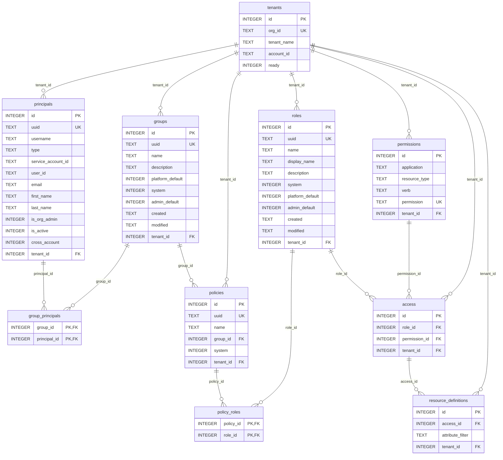

# rbac-go Data Model (ERD)

Portable SQLite + Postgres schema ([internal/store/store.go](../internal/store/store.go)). Ten tables;
UUIDs and timestamps are `TEXT`, booleans are `INTEGER 0/1`, `attribute_filter`
is a JSON `TEXT` blob. Every business table carries `tenant_id`.



## How the hot path joins it

`GET /api/rbac/v1/access/` ([internal/access/access.go](../internal/access/access.go)) walks one query:

```
tenants → principals (org_id + lower(username))
  → group_principals → groups
      (own tenant groups
       + platform_default of tenant and public tenant
       + admin_default of tenant and public tenant when org admin)
  → policies → policy_roles → roles → access → permissions (+application filter)
  → LEFT JOIN resource_definitions (JSON decoded in Go, grouped per permission)
```

Provisioning writes it without an ORM:

* `seed.Seed` — `public` tenant + `Cost Administrator`
  (`cost-management:*:*`) + `Sources administrator` (`sources:*:*`).
* `seed.Bootstrap` — tenant + `CI Test Admin` group + policy + principals.
* `keycloak.Sync` — tenant ensure + principal upserts/prunes (+ group
  membership only in single-org mode).
