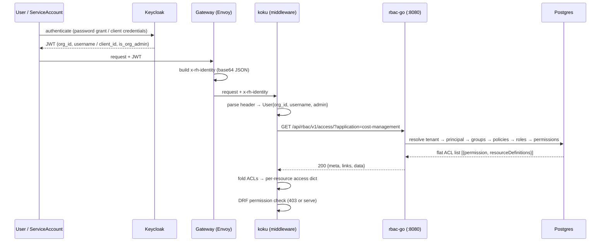
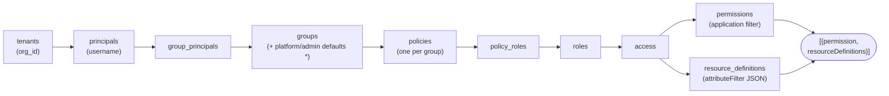

# rbac-go request guide: from Keycloak login to koku access decision

How an authenticated request becomes an RBAC access list, end to end.
For the API contract see [SPEC.md](SPEC.md), for the schema [ERD.md](ERD.md).

## 1. The chain

Step by step:

1. **Keycloak → header.** The user (or service account) authenticates against
   Keycloak. The gateway builds the `x-rh-identity` header: base64 JSON with
   `org_id`, `identity.type` (`User`/`ServiceAccount`), `username`,
   `is_org_admin`, and `client_id` for service accounts
   ([`internal/identity`](../internal/identity) parses and lowercases this).
2. **koku parses it** ([`koku/koku/middleware.py`](https://github.com/project-koku/koku/blob/main/koku/koku/middleware.py)) into a `User` object —
   org, username, admin flag. It does *not* know RBAC yet; it asks us:
   `GET /api/rbac/v1/access/?application=cost-management` with that header.
   Non-200 answers become `[]` (deny); connection errors/5xx become HTTP 424.
3. **rbac-go resolves the principal**: the `principals` row matching
   `(username, tenant_id)` — the tenant comes from `org_id` (`tenants` table).
   Unknown user → empty list (deny).
4. **Group membership**: `group_principals` join → the tenant's groups,
   **plus** auto-included platform-default groups (tenant's *and* the public
   tenant's `Default access`) and, for org admins, admin-default groups.
   The caller is treated as a member of those groups without a row.
5. **Group → roles**: `policies` (each belongs to exactly one group) →
   `policy_roles` → `roles`.
6. **Roles → permissions**: `access` rows → `permissions`
   (`application:resource:verb`), filtered by the requested `application`,
   plus `resource_definitions` (`attributeFilter` JSON: `equal`/`in` with
   values like project names or cluster IDs).
7. **Back in koku**: it folds that flat ACL list into the per-resource access
   dict (`aws.account: {read: [...]}`, `cost_model: {read, write}`, OCP
   cluster→node→project inheritance, `*` compaction) that its DRF permission
   classes check ([`internal/contract`](../internal/contract) is our Go port of that mapping).
   Three koku-side rewrites to know about: `sources:*:*` arrives from RBAC
   verbatim but is rewritten to `sources:sources:*` *before* bucketing —
   otherwise the `*` resource type fans out across every bucket;
   legacy `cost-management:rate:*` means `cost_model`; write implies read.
   Full rules: [doc/KOKU-NEEDS.md](KOKU-NEEDS.md) §2.

   **Permission notation.** Every grant is an `application:resource:verb`
   triple. `sources:*:*` reads as application=`sources`,
   resource_type=`*` (any), verb=`*` (any) — i.e. "do anything in sources".
   RBAC stores and serves it verbatim; koku rewrites the middle segment to
   `sources:sources:*` before bucketing so it lands in the flat `sources`
   bucket instead of the `*` wildcard bucket (which would fan out across
   *every* resource type). Other examples: `cost-management:aws.account:read`
   (read AWS accounts), `cost-management:*:*` (everything in
   cost-management). See [doc/KOKU-NEEDS.md](KOKU-NEEDS.md) §2 and
   [`internal/contract.NormalizeSourcesACL`](../internal/contract/contract.go).

## 2. The data path (one query)

`GET /access/` resolves in a single join ([`internal/access`](../internal/access); full schema with
all tables and FKs: [doc/ERD.md](ERD.md)):

`*` The platform/admin-default groups are injected by the query itself
(`g.platform_default = 1 … OR g.admin_default = 1` for org admins) —
no membership rows needed. See [FINDINGS.md](FINDINGS.md) §“live-cluster test” for why:
without this, on-prem loses the public `Default access` grants.

## 3. Where the pieces live

* Identity parsing: [`internal/identity`](../internal/identity) (+ [SPEC.md](SPEC.md) §4).
* Join + filters + pagination: [`internal/access`](../internal/access); schema: [doc/ERD.md](ERD.md).
* koku-side folding port (normalize/process/apply, OCP inheritance):
  [`internal/contract`](../internal/contract) — proves our output is consumable by koku's mapping.
* Tenant/group/principal provisioning: [`seed.Bootstrap`](../internal/seed/seed.go), [`keycloak.Sync`](../internal/keycloak/keycloak.go).
* Full endpoint list: [SPEC.md](SPEC.md) §1–§2, OpenAPI subset:
  [doc/openapi.v1-subset.json](openapi.v1-subset.json).
