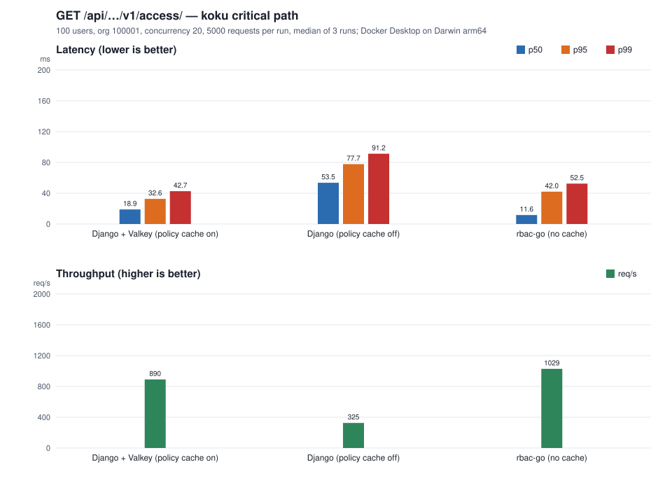
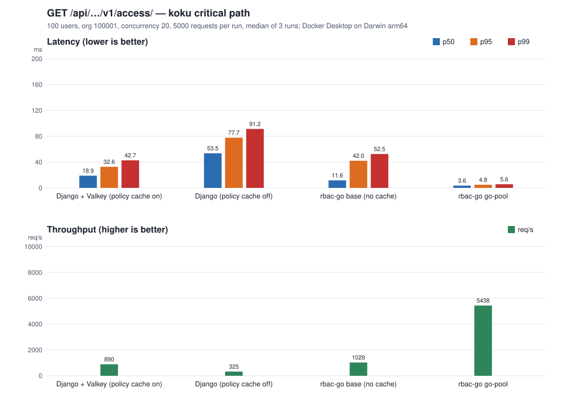

# Load test: GET /api/rbac/v1/access/ (koku critical path)

This measures the one endpoint koku calls on its hot path. It records a baseline of
three configurations, then measures each optimization stage against that baseline:

1. **Django + Valkey (policy cache on)**: stock insights-rbac, the access policy cached per principal in Valkey.
2. **Django (policy cache off)**: the same service with `ACCESS_CACHE_ENABLED=False`.
3. **rbac-go, base**: rbac-go at commit `0356acd`, no connection pool settings.
4. **rbac-go, go-pool**: rbac-go at commit `d2c78c4`, with the Postgres connection pool sized.

Question this answers: does rbac-go need its own cache before on-prem rollout, or does
koku's per-user cache already cover it? The pool stage shows the first cheap fix on the
rbac-go side.

Everything here is reproducible with the scripts in [scripts/loadtest/](../scripts/loadtest/).
Raw results, the environment record, the generated reports and the charts are committed
under [scripts/loadtest/results/](../scripts/loadtest/results/), one directory per stage.

## Recorded baseline



Median of 3 runs per configuration, 5000 measured requests per run, 100 users,
concurrency 20. Latencies in ms. Max is the worst single run. Full per-run numbers are
in [REPORT.md](../scripts/loadtest/results/baseline/REPORT.md). The baseline was not
changed by the later stages.

| System | runs | rps | mean ms | p50 ms | p95 ms | p99 ms | max ms (worst run) | errors |
|---|---:|---:|---:|---:|---:|---:|---:|---:|
| Django + Valkey (policy cache on) | 3 | 890 | 20.5 | 18.9 | 32.6 | 42.7 | 738.7 | 0 |
| Django (policy cache off) | 3 | 325 | 55.2 | 53.5 | 77.7 | 91.2 | 788.5 | 0 |
| rbac-go base (no cache) | 3 | 1029 | 18.9 | 11.6 | 42.0 | 52.5 | 86.8 | 0 |

What the baseline says:

* **The Django cache is worth about 2.8×** on median latency (53.5 → 18.9 ms) and 2.7× on
  throughput (325 → 890 req/s).
* **rbac-go without a cache beats Django without one on every metric**: 4.6× lower median
  (11.6 vs 53.5 ms), 3.2× the throughput, and about 55–60% of Django's p95 and p99.
* **rbac-go without a cache has a better median and throughput than Django with its cache**,
  but a worse tail: p95 42.0 vs 32.6 ms, p99 52.5 vs 42.7 ms. The tail was the open problem,
  and the pool stage below addressed it ([Finding 2](#findings)).

## Stage: rbac-go with a sized connection pool (go-pool)



The change is in [store.go](../internal/store/store.go), commit `d2c78c4`: the Postgres
pool sets `MaxOpenConns` 25, `MaxIdleConns` 25, `ConnMaxIdleTime` 5 min and
`ConnMaxLifetime` 30 min. Before, `database/sql` ran with its defaults, which keep only two
idle connections. The test
[pool_test.go](../internal/store/pool_test.go) asserts the open limit. Both SQLite and
Postgres 16 suites and the linter pass.

Same load profile as the baseline. Full per-run numbers are in
[REPORT.md](../scripts/loadtest/results/go-pool/REPORT.md).

| System | runs | rps | mean ms | p50 ms | p95 ms | p99 ms | max ms (worst run) | errors |
|---|---:|---:|---:|---:|---:|---:|---:|---:|
| Django + Valkey (policy cache on) | 3 | 890 | 20.5 | 18.9 | 32.6 | 42.7 | 738.7 | 0 |
| Django (policy cache off) | 3 | 325 | 55.2 | 53.5 | 77.7 | 91.2 | 788.5 | 0 |
| rbac-go base (no cache) | 3 | 1029 | 18.9 | 11.6 | 42.0 | 52.5 | 86.8 | 0 |
| **rbac-go go-pool** | 3 | **5438** | **3.6** | **3.6** | **4.8** | **5.6** | **16.1** | 0 |

Against the rbac-go base row: 5.3× the throughput, 3.2× lower median, 8.8× lower p95,
9.4× lower p99, and the worst run's max drops from 86.8 to 16.1 ms.

Against Django with its cache on, the pool build is 6.1× the throughput with a p95 of 4.8
ms instead of 32.6 ms.

Verification that the faster responses are the same answer: a direct request for the same
user returns the same permission (`cost-management:*:*`, count 1) from rbac-go and from
Django. The load tool only counts status codes, so this check covers the body.

### The same change, measured natively

Same change, rbac-go as a host process, no containers. The SQLite row is a control: SQLite
keeps a single connection, so the pool change should not affect it.

| System | runs | rps | mean ms | p50 ms | p95 ms | p99 ms | max ms (worst run) | errors |
|---|---:|---:|---:|---:|---:|---:|---:|---:|
| rbac-go native, SQLite, before ([native](../scripts/loadtest/results/native/REPORT.md)) | 3 | 4495 | 4.3 | 3.7 | 9.7 | 13.8 | 28.2 | 0 |
| rbac-go native, SQLite, after ([native-pool](../scripts/loadtest/results/native-pool/REPORT.md)) | 3 | 4393 | 4.4 | 3.8 | 10.1 | 13.7 | 33.3 | 0 |
| rbac-go native, Postgres 16, before ([native](../scripts/loadtest/results/native/REPORT.md)) | 3 | 2729 | 7.0 | 2.3 | 23.9 | 29.1 | 54.5 | 0 |
| rbac-go native, Postgres 16, after ([native-pool](../scripts/loadtest/results/native-pool/REPORT.md)) | 3 | 12516 | 1.6 | 1.4 | 3.2 | 4.5 | 10.4 | 0 |

The Postgres row shows the pool is the cause of the tail, not the container or the VM: p95
falls from 23.9 to 3.2 ms with no Docker in the path. The SQLite control is unchanged within
noise.

## Footprint

What CPU and memory the three serving paths needed while the load test ran. Measured
with [footprint.sh](../scripts/loadtest/footprint.sh), which samples `docker stats`
about once a second during the measured runs and wraps the load tool in
`/usr/bin/time -l`. Raw samples, time reports and the generated
[FOOTPRINT.md](../scripts/loadtest/results/footprint/FOOTPRINT.md) are committed.

Measurement conditions differ from the baseline on purpose: the request counts per run are
larger (12000, 30000 and 100000, sized so each run lasts long enough to sample), so this
stage's latency numbers are not compared with the baseline. Its `ENV.txt` records the same
Go commit as `go-pool` (`3abc329`, clean tree for the Go code).

Each figure is a mean or peak over the load window on one M1 Max, in one Docker Desktop VM
with 10 CPUs and 7.75 GiB. The two app containers share that VM with Postgres and Valkey.
Neither app had a CPU or memory limit set.

| Configuration | containers on the path | mean CPU (cores) | peak CPU (cores) | peak memory (MiB) | rps | CPU ms per request |
|---|---|---:|---:|---:|---:|---:|
| rbac-go (no cache) | rbac-go, Postgres | 2.76 | 2.94 | 407 | 5382 | 0.51 |
| Python + Valkey: Django, policy cache on | Django, Postgres, Valkey | 4.76 | 7.74 | 2552 | 876 | 5.43 |
| Python: Django, policy cache off | Django, Postgres | 5.00 | 6.49 | 2762 | 310 | 16.12 |

Column notes:

* **CPU** is summed over the containers on the path, per sample, so the peak is the peak of
  the sum. `docker stats` reports 100% as one core.
* **CPU ms per request** is mean path CPU in cores × 1000 ÷ rps. It is the figure that
  carries to another machine, because it does not depend on how many requests that machine
  manages at once.
* **Memory** is `docker stats` memory at its peak. The Go path is 387 MiB of Postgres plus
  about 20 MiB of rbac-go. The Python paths are about 2.1 to 2.3 GiB of Django (22
  processes) plus Postgres.

What it says:

* **Python costs about 10× the Go path per request, or about 30× without its cache**
  (5.43 ms vs 0.51 ms, and 16.12 ms with the policy cache off).
* **Django needs about 2.1 to 2.3 GiB** at this concurrency, against about 20 MiB for
  rbac-go. 22 processes at roughly 100 MiB each is the bulk of it. The container grows from
  about 300 MiB before load to its peak, and did not come back down once its workers had
  served requests.
* **The cache moves work from Postgres to Python.** Django's own CPU barely changes between
  the two Python rows (about 4 to 4.3 cores), but Postgres drops from about 1.0 to 0.3
  cores, and Valkey takes about 0.15. That is why the cached row is 2.8× faster while
  costing about a third of the CPU per request.
* **Valkey is small in memory (14 MiB) but not free in CPU**: about 0.15 cores at 876 req/s
  (15% in `docker stats` terms). Each cached read does a health-check ping plus the read.
* **The load generator is not the bottleneck at these rates**: 0.61 cores and 41 MiB at
  5382 req/s. It is still one Python process, so it may cap the highest rps figures; see
  [Open items](#open-items).

### Estimate for sizing

Derived from the CPU ms per request above, so it inherits its caveats. Not a capacity plan:
the measurement is one concurrency (20), one data shape, and no limits set on the
containers.

| Path | cores at 100 req/s | cores at 1000 req/s | memory to budget |
|---|---:|---:|---|
| rbac-go + Postgres | about 0.05 | about 0.5 | 512 MiB (Postgres is about 390) |
| Python + Valkey + Postgres | about 0.54 | about 5.4 | about 3 GiB |
| Python (cache off) + Postgres | about 1.6 | about 16 | about 3 GiB |

Read it as: Django costs an order of magnitude more in both CPU and memory at the same
request rate. On a 10-core node, the Go path leaves plenty of headroom where the Python
path would need most of the box and several GiB.

## Reproduce

### Prerequisites

* Docker (Docker Desktop was used; `host.docker.internal` must resolve from containers).
* Python 3 (stdlib only; no packages to install).
* `curl`, `git`.
* Go 1.27 toolchain, for [native.sh](../scripts/loadtest/native.sh) and the tests.
* `psql` on the host, for the native Postgres row only.
* Network access: the scripts pull `postgres:18.1` and `valkey/valkey:8`, build the rbac-go
  image (`golang:1.27` base), and build the insights-rbac image (`registry.access.redhat.com`
  base).

### Layout assumed by the scripts

The scripts assume rbac-go is checked out inside the insights-rbac repository:
`insights-rbac/rbac-go/`. The Django image is built from the parent directory. Override with
`RBAC_GO_DIR` and `INSIGHTS_RBAC_DIR` if the layout differs.

### Run the baseline

```bash
scripts/loadtest/baseline.sh
```

This runs, in order:

1. [up-baseline.sh](../scripts/loadtest/up-baseline.sh): starts the Postgres and Valkey containers and sets `max_connections=300`.
2. [up-django.sh](../scripts/loadtest/up-django.sh) `off`, then the measurement for `django-nocache` (`RUNS` runs).
3. [up-django.sh](../scripts/loadtest/up-django.sh) `on`, then the measurement for `django-warm` (`RUNS` runs).
4. [up-go.sh](../scripts/loadtest/up-go.sh), then the measurement for `go` (`RUNS` runs).
5. [capture-env.sh](../scripts/loadtest/capture-env.sh): writes `ENV.txt`.
6. [report.py](../scripts/loadtest/report.py): writes `REPORT.md` and `report.svg`.

Add `REBUILD=1` to rebuild the rbac-go and Django images from the checkouts first.

The first Django migration on an empty Postgres took about 10 minutes when this was recorded.
Later runs reuse the database and take a few minutes in total.

### Measure a new rbac-go build as a stage

```bash
STAGE=go-pool scripts/loadtest/go-stage.sh
```

This rebuilds the rbac-go image from the checkout, runs `RUNS` measurements into
`results/<STAGE>/`, captures `ENV.txt`, and writes a report that includes the Django and base
rbac-go rows from `results/baseline/`. The stage name must not be `baseline`. It is recorded
in `ENV.txt`, so note the commit you measured before committing the results.

### Measure the footprint

```bash
STAGE=footprint scripts/loadtest/footprint.sh
```

Same order as [baseline.sh](../scripts/loadtest/baseline.sh), plus a `docker stats` sampler and `/usr/bin/time -l` around
each load run. Request counts per run are raised (12000, 30000, 100000) so that each run
lasts long enough to sample; see [Footprint](#footprint).

### Run the native reference rows

```bash
NATIVE_PG_ADMIN_DSN='postgres://me@127.0.0.1:55432/postgres?sslmode=disable' \
NATIVE_PG_DSN='postgres://me@127.0.0.1:55432/rbacgo_native?sslmode=disable' \
  scripts/loadtest/native.sh
```

Leave the two variables unset to measure SQLite only. Set `STAGE=native-pool` to write into
`results/native-pool/` instead of `results/native/`. The script builds the rbac-go binary,
starts it as a host process on a local port, measures it, and stops it. The Postgres database
`rbacgo_native` is dropped and recreated.

### Other entry points

| Command | Use |
|---|---|
| `scripts/loadtest/measure.sh <label> <port> <api-prefix>` | Measure one running configuration `RUNS` times |
| `scripts/loadtest/teardown.sh [--all]` | Remove the app containers; `--all` also removes Postgres and Valkey |
| `STAGE=<name> scripts/loadtest/...` | Write results to `results/<name>/` instead of `results/baseline/` |

### What each script does

| Script | Does |
|---|---|
| [env.sh](../scripts/loadtest/env.sh) | Shared settings, the probe identity, and helpers. Sourced by every other script |
| [baseline.sh](../scripts/loadtest/baseline.sh) | Runs the full baseline in the order above |
| [go-stage.sh](../scripts/loadtest/go-stage.sh) | Rebuilds and measures rbac-go as a named stage, then reports it against the baseline |
| [footprint.sh](../scripts/loadtest/footprint.sh) | Measures the same three configurations with container CPU/memory sampling and the load generator's own time report |
| [footprint_report.py](../scripts/loadtest/footprint_report.py) | Writes `FOOTPRINT.md` from the samples and time reports |
| [up-baseline.sh](../scripts/loadtest/up-baseline.sh) | Postgres and Valkey containers; sets `max_connections` (stops app containers first, because `ALTER SYSTEM` needs a free connection) |
| [up-django.sh](../scripts/loadtest/up-django.sh) | Django image, migrate, [django_fixture.py](../scripts/loadtest/django_fixture.py), container with `ACCESS_CACHE_ENABLED` set by `on` or `off` |
| [up-go.sh](../scripts/loadtest/up-go.sh) | rbac-go image; drops and recreates the `rbacgo` database; migrate, seed, bootstrap; container |
| [measure.sh](../scripts/loadtest/measure.sh) | Thin wrapper around `measure_config` in [env.sh](../scripts/loadtest/env.sh) |
| [loadtest.py](../scripts/loadtest/loadtest.py) | The load generator (stdlib only) |
| [capture-env.sh](../scripts/loadtest/capture-env.sh) | Writes `ENV.txt`: commits and uncommitted changes, image IDs, server versions, host |
| [report.py](../scripts/loadtest/report.py) | Writes `REPORT.md` and `report.svg`; `--group STAGE/LABEL=TITLE` reads another stage |
| [native.sh](../scripts/loadtest/native.sh) | Native reference rows |
| [teardown.sh](../scripts/loadtest/teardown.sh) | Removes containers |

### Settings

Set these in the environment to override the defaults in [env.sh](../scripts/loadtest/env.sh):

| Variable | Default | Meaning |
|---|---|---|
| `RUNS` | 3 | Measured runs per configuration |
| `REQUESTS` | 5000 | Measured requests per run (after a prime pass and 200 warmup requests) |
| `CONCURRENCY` | 20 | Concurrent threads, each with one keep-alive connection |
| `USER_COUNT` | 100 | Users `loaduser-0` .. `loaduser-(N-1)` in one group |
| `ORG_ID`, `ACCOUNT` | `100001`, `1111111` | Tenant the users belong to |
| `PG_MAX_CONNECTIONS` | 300 | Postgres `max_connections` for the baseline database |
| `PG_PORT`, `VALKEY_PORT`, `DJANGO_PORT`, `GO_PORT` | 15433, 16379, 18092, 18093 | Host ports |
| `RBAC_GO_DIR`, `INSIGHTS_RBAC_DIR` | derived from the script location | Checkout locations |
| `STAGE` | `baseline` | Results subdirectory under `results/` |

The pool sizes are constants in [store.go](../internal/store/store.go), not environment
settings. Changing them means a rebuild and a new stage.

## Setup

| Component | Version | Runs as | Notes |
|---|---|---|---|
| rbac-go, base | commit `0356acd`, image `rbac-go:loadtest` | container, port 18093 | [Dockerfile](../Dockerfile); migrates on start |
| rbac-go, go-pool | commit `d2c78c4`, image `rbac-go:loadtest` | container, port 18093 | same, plus the pool settings |
| insights-rbac (Django) | commit `aa7fd4b`, image `rbac-django-baseline` | container, port 18092 | gunicorn from the image; `CONN_MAX_AGE=60` per [settings.py](https://github.com/RedHatInsights/insights-rbac/blob/master/rbac/rbac/settings.py) |
| Postgres | `postgres:18.1` (server 18.1) | container `rbac-baseline-db`, port 15433 | `max_connections = 300` |
| Valkey | `valkey/valkey:8` (server 8.1.6) | container `rbac-baseline-redis`, port 16379 | Django access cache uses DB 1 |

Host: Apple M1 Max, 10 logical CPUs, macOS (Darwin arm64), Docker server 29.4.0. Each
stage's full record is in its `ENV.txt`, which also lists the tracked files that were
uncommitted when the stage ran.

Apps reach Postgres and Valkey through `host.docker.internal`. The load generator runs on
the host and hits the published ports.

### Data

Org `100001`, account `1111111`, 100 users `loaduser-0` .. `loaduser-99`, all in one group
with a `cost-management:*:*` grant.

* rbac-go: `migrate`, `seed`, `bootstrap --org 100001 --account 1111111 --users …`.
* Django: `migrate`, then [django_fixture.py](../scripts/loadtest/django_fixture.py)
  creates the same tenant, users, group, role and grant.

### Load profile

`GET <prefix>/access/?application=cost-management&limit=100` with a per-user
`X-Rh-Identity` header. The Django prefix is `/api/v1`; the rbac-go prefix is `/api/rbac/v1`.

1. One sequential prime request per user, excluded from the stats. This makes the first
   measured request for each user a cache hit when the cache is on.
2. 200 warmup requests, excluded.
3. The measured requests: each picks a user uniformly at random, seeded per thread.

### What the two Django modes change

`ACCESS_CACHE_ENABLED` controls the per-principal access policy cache in
[cache.py](https://github.com/RedHatInsights/insights-rbac/blob/master/rbac/management/cache.py)
and [access/view.py](https://github.com/RedHatInsights/insights-rbac/blob/master/rbac/management/access/view.py).
The tenant and principal caches stay on in both modes. The "policy cache off" row therefore
still has Valkey round trips for tenant and principal lookups. It does not measure a Django
with no Redis at all.

## Measurement method

[loadtest.py](../scripts/loadtest/loadtest.py) writes one JSON file per run:

* `rps`: successful requests divided by wall-clock elapsed time.
* `mean_ms`, `p50_ms`, `p95_ms`, `p99_ms`, `max_ms`: over successful (200) responses.
* `errors`: non-200 responses plus exceptions. The tool does not record which kind, so a
  cause has to be inferred from logs.

[report.py](../scripts/loadtest/report.py) takes the median of the runs for each latency and
throughput value, the worst max, and the sum of errors. Medians are used because single runs
of the container configurations vary.

## Findings

1. **The Django cache is worth about 2.8× on median latency and throughput.** Without it
   (53.5 ms, 325 req/s) Django is well behind rbac-go on every metric. With it (18.9 ms,
   890 req/s) it has the best p95 and p99 in the baseline. The cache hits were verified during
   setup: a repeated identical request logged no policy write, and the Valkey
   `rbac::policy::*` keys were present after a run. The footprint section also shows what the
   cache buys in resources: Postgres drops from about 1.0 to 0.3 cores, while Django's own CPU
   stays about the same.

2. **The rbac-go tail was connection churn, and the pool fixes it (verified).** Before the
   change, rbac-go ran `database/sql` with its defaults, which keep only two idle connections.
   At concurrency 20 each burst closed and reopened connections. With the pool sized
   ([store.go](../internal/store/store.go), commit `d2c78c4`):
   * container: p95 42.0 → 4.8 ms, p99 52.5 → 5.6 ms, throughput 1029 → 5438 req/s;
   * native Postgres: p95 23.9 → 3.2 ms, throughput 2729 → 12516 req/s;
   * native SQLite control: unchanged within noise (p95 9.7 → 10.1 ms).
   Django keeps its connections across requests (`CONN_MAX_AGE=60`), which the pool now matches
   between the two.

3. **The earlier container stalls are not seen with the pool.** In an earlier session, two of
   three rbac-go container runs each held one request for about 20–30 s (one counted as an
   error, the tool's 30 s socket timeout, inferred from the elapsed time). Those runs used the
   base build. Neither the baseline runs nor the three go-pool runs showed a stall (worst max
   86.8 and 16.1 ms). Three runs per setting cannot rule out intermittent stalls, so keep
   reading the max and elapsed columns in every stage.

4. **Django needs `max_connections` raised for this workload.** At the default of 100, 51 of
   2000 requests returned 500 with `too many clients already`. Each gunicorn worker thread
   holds its own persistent connection, so the connection budget has to cover workers ×
   threads. The benchmark sets 300 on the test database so the run measures the request path,
   not connection exhaustion. On-prem sizing should use the same arithmetic.

5. **Single slow requests on Django.** Three Django runs had a worst request of 0.7 to 0.8 s:
   warm run 1 (738.7 ms) and no-cache runs 1 and 2 (788.5 ms and 782.4 ms). The other Django
   runs peak at 157 ms or below. The cause is not established. Candidates are gunicorn workers
   opening their first database connections under load. The max column shows the worst run, so
   these are visible in the table.

6. **Earlier numbers were invalid and were replaced.** The first version of the tool walked the
   user list in lockstep, so all 20 threads hit the same user at once. That caused a cache
   stampede on each user's first request. The first Django run (377 req/s, mean 53 ms) was an
   artifact of it. The tool now picks users at random per thread and primes each user once.
   Every number in this document comes from the fixed tool.

## Open items

* **Concurrency sweep for the pool**: `MaxOpenConns` is 25 and the load runs at 20, so the pool
  is not the limit here. Run `CONCURRENCY=50` and `CONCURRENCY=100` on the go-pool build to see
  where requests start queuing for a connection, and whether the 25 needs to move.
* **On-prem connection budget**: each rbac-go process can hold up to 25 Postgres connections.
  The sum over replicas, plus Django's workers × threads, has to stay under `max_connections`.
  This is not checked anywhere yet.
* **Profile the remaining cost**: the container p50 is 3.6 ms and the native Postgres p50 is
  1.4 ms. The query plan and the JSON encoding are the next things to look at, but no profile
  has been taken.
* **Remove `host.docker.internal` from the path**: put Postgres, Valkey and both apps on one
  user-defined bridge network, to measure the container overhead without the Docker VM hop.
* **Record error kinds** in [loadtest.py](../scripts/loadtest/loadtest.py) (status code or exception class), so a stall like
  Finding 3 can be attributed without inference.
* **Load generator headroom**: at 5382 req/s the client used 0.61 cores in one Python process.
  Check whether it caps the highest rps figures by running the same profile from two clients, or
  from a client on another host.
* **Footprint with limits**: this measured no container CPU or memory limits. The per-process
  view for Django (22 processes, about 2.1 GiB) is the input for a Kubernetes request and limit,
  and that has not been translated yet.
* **More data shapes**: one org, one group, one role here. Real koku traffic spans many orgs,
  groups and principals.
* **Django log error**: `Role seeding failed` (`ValueError: badly formed hexadecimal UUID`)
  appears at container start. It was not investigated. The measurement does not depend on
  seeds, because the fixture creates its own role and grant.

## Artifacts

Per stage, under [scripts/loadtest/results/](../scripts/loadtest/results/):

| Stage | Content |
|---|---|
| [baseline](../scripts/loadtest/results/baseline/) | Django cache on, Django cache off, rbac-go base; three runs each |
| [go-pool](../scripts/loadtest/results/go-pool/) | rbac-go with the pool; three runs, plus the baseline rows for comparison |
| [native](../scripts/loadtest/results/native/) | rbac-go as a host process, before the pool; SQLite and Postgres |
| [native-pool](../scripts/loadtest/results/native-pool/) | the same, after the pool; SQLite is the control |
| [footprint](../scripts/loadtest/results/footprint/) | the three configurations with CPU/memory sampling, run JSON, time reports and [FOOTPRINT.md](../scripts/loadtest/results/footprint/FOOTPRINT.md) |

Each directory holds:

| File | Content |
|---|---|
| `<label>-<n>.json` | One run: the load tool's output |
| `ENV.txt` | Commits (with uncommitted changes listed), image IDs, server versions, host, load profile |
| `REPORT.md` | Medians table and per-run table |
| `report.svg` | The chart embedded in this document (where a stage has one) |
| `<label>-server.log` | Native stages only: rbac-go server log |
